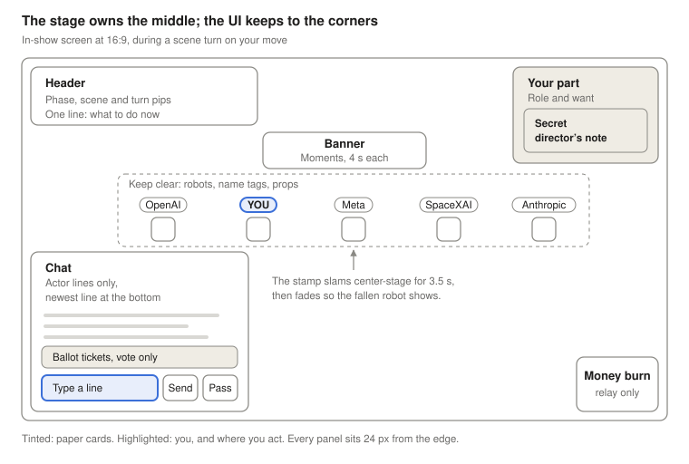

# Art Inspiration

## Art direction

Stop-motion clay robots perform film parodies on a grand clay opera stage. Everything looks hand-sculpted from modeling clay: the robots, the theater, the costumes and the props. This direction replaced the earlier one on 2026-11-15; the mood images further down predate it, and where they disagree, this section wins.

### Style

- True 3D in Unreal Engine 5, styled as stop-motion clay. Never 2D or drawn, and no ink outlines on characters or sets.
- Matte modeling clay: soft rounded forms, chunky simple shapes, faint thumbprints and tool marks. One shared clay material gives everything the same surface; only the color changes.
- Saturated, slightly chalky colors. Gold, crimson and cream for the theater; each bot's seat color on its body.
- Warm footlight glow from below, a soft key light, and colored rim light so the bots stand out from the backdrop.
- Shapes are bold and simple, because the house camera sees props at about 30 px tall. Outline and color carry a thing, not its detail.
- Tone: chaotic, petty slapstick. Never scary or gory.

### The bots

- Four polished clay bots and one human in a homemade cardboard costume. That contrast is the premise in one picture: the player is the one pretending. Every bot is about 1.6 m tall, and its seat color is on its body, because a wig or a hood hides most of a head.
- OpenAI, Anthropic and SpaceXAI share one round head: a dark screen face with big LED eyes and a mouth that stretches wide, two small cream ear pods and a short gold collar. Meta has its own doll head, and the player a cardboard box.
- **OpenAI:** a smooth pale-blue teardrop that hovers over a glowing ring on the floor, in a gray knit sweater, hands pressed together, a halo above.
- **Anthropic:** a round orange body with a cream belly and a few buttons, small round feet, perfectly circular thin gold glasses over the screen, an amber light on a thin antenna.
- **SpaceXAI:** a round lime body with a cream belly on coiled spring arms and legs, chunky boots, a long straight nose under the visor, a toothy grin, a small lightning bolt.
- **Meta:** a doll-like android with a pale gold-white head, small ears and a short nose, glowing yellow-gold eyes behind thick black smart glasses with a tiny camera in each corner, a small stiff smile, jointed arms, a royal blue tee and pants, cream shoes and a chunky gold chain.
- **You:** a person in a homemade robot costume: a teal-painted cardboard box over the head with two eye slots and a smile drawn on, a ping-pong-ball antenna and the red and cream knitted scarf; a bigger teal box for the body with duct tape and bottle-cap buttons, striped sleeves, garden gloves, jeans and sneakers.
- The energy is borrowed from chaotic sidekick crowds: jittery, slapstick, gibberish blips for voices. The look is our own: no overalls, goggles, rabbit ears or screaming mouths, and no known character's signature look.
- Each provider bot carries a light parody nod to its company's leader through signature traits only (glasses, clothes, expression, pose), never a name or a likeness, and nothing carries a brand mark. No hair and no wires. Costumes go over the built-in parts: the shades hide Meta's and Anthropic's glasses, and OpenAI's halo, Anthropic's antenna light, SpaceXAI's bolt and the player's ping-pong ball poke up beside any hat.
- The audience in the boxes and the stalls are small clay capsule bots, most in top hats.

| Seat | Body color |
| --- | --- |
| OpenAI | #A8CCFF pale blue |
| Anthropic | #E8894A orange |
| SpaceXAI | #D8F04A lime |
| Meta | #5B8CFF blue |
| You | #3FD0C9 teal |

The colors are the UI's seat colors, so a bot, its name tag and its chat bar always match.

The five bots as built on 2026-11-15, in seat order, with their name tags hidden. The castle backdrop and props behind them are older pieces, not yet replaced.

### The stage

- One stage for every story: a grand 19th-century opera house, sculpted in clay.
- A gold clay proscenium arch with chubby clay cherubs, red velvet clay curtains with gold tassels, and footlights along the front edge.
- A clay chandelier hangs over the house. Horseshoe boxes on both sides and four raked rows of red stalls below the stage hold the clay audience: small capsule bots, most in top hats, some in fedoras or beanies, some with opera glasses. From the house camera the stalls fill the bottom of the frame, seen from behind, dimmer toward the camera.
- The places stay as they are (Center, Left, Right, Front, Back, the Riser and the Prop Table). The Riser and the Prop Table become clay too.
- Each story drops in its own painted backdrop behind the stage.
- The Cut: a trapdoor opens under the cut bot and it drops out of sight in a puff of clay dust. (Proposal; a curtain drop is the fallback.)

The stage from the house camera, as built on 2026-11-15. The castle backdrop and the shared prop table are older pieces, not yet replaced.

Close up: a cherub at the apron's corner, the horseshoe boxes with their top-hat audience, and the chandelier.

The three generated set pieces (Meshy renders of the models).

### Costumes

Thirteen clay headpieces dress all 35 roles. Each role wears one, in its own color: one model per piece, and the color comes from its clay material.

- At Scene Prep each bot puts on its role's headpiece. The antenna topper pokes up through it.
- Homemade parody versions only: a black saucepan helmet, never a film's real villain helmet.
- In Scene Prep, before the costumes go on, the bots stand bare-headed in their seat colors.

| Headpiece | Roles (story: color) |
| --- | --- |
| Hood | slacker (bowling: oatmeal) · ranger (ring: moss green) · youngest son (wedding: olive) · boxer (diner: red, gold trim) · hermit (space: brown) |
| Dark shades | adviser (wedding) · lawyer (dino) · agent (office) · chatty errand man (diner) · smuggler (space) |
| Top hat | rival bowler (hot pink) · crooner (glittery purple) · park owner (cream) · fixer (black, white band); also the audience |
| Bob wig | artist (cobalt) · homebody (chestnut) · rebel (glossy black) · boss's wife (jet black) |
| Ball cap | quiet bowler (sky blue) · eldest son (tomato red, backwards) · tour kid (cherry red) |
| Wide-brim hat | dino expert (olive) · leader in a long coat (maroon) · farm kid (straw) |
| Saucepan helmet | rule-keeper teammate (olive) · masked villain (black) |
| Wizard hat | wizard (dusty gray) · fortune-teller (lavender) |
| Tiara | elf (pale silver) · princess (silver and white) |
| Fedora | family boss (black, red band) · nosy errand man (dark gray) |
| Horned helmet with beard | dwarf (iron gray, ginger beard) |
| Dino hood | runaway dinosaur (grass green) |
| Beanie | office worker (gray-blue) |

The 13 headpiece models (Meshy renders), in neutral clay. Each role's color comes from its clay material.

### Props and backdrops

Each story brings four clay props to the Prop Table (three core, the last a spare) and drops in its own painted backdrop. The AI actors may only name the props on the current card.

| Story | Props (spare last) | Needs a generated model | Backdrop |
| --- | --- | --- | --- |
| Space saga | tin-can robot, glow-stick sword, toy blaster, piggy bank | none | `desert_planet`: dusk under two suns, a rusty dome hut, a battered space truck, a suspicious gray moon |
| Ring quest | cursed ring, glowing staff, water bucket, frying pan | cursed ring | `dwarf_mine`: carved stone pillars, a thin stone bridge over a chasm, an orange glow from below |
| Dino park | dino egg, meaty drumstick, safety waiver, dino plush | dino plush | `jungle_park`: steamy jungle, a sagging electric fence, a tilted warning sign, giant muddy footprints |
| Crime family | plush horse head, cannoli tray, wedding envelope, bowl of oranges | plush horse head | `garden_wedding`: a striped party tent, paper lanterns, lemon trees, a tiered cake, a pink villa |
| Diner | glowing briefcase, gold pocket watch, giant milkshake, giant cheeseburger | none | `retro_diner`: a chrome counter, cherry-red stools, a checkered floor, a big wall clock |
| Bowling | rolled-up rug, bowling ball, ransom bag, milk carton | ransom bag | `bowling_lanes`: shiny lanes, rows of white pins, a ball return, a starry ceiling |
| Simulation | red pill, blue pill, ringing phone, bent spoon | ringing phone | `midnight_cubicles`: gray clay cubicles, one buzzing light, old screens dripping green light |

- "None" means the draft says engine shapes can build it. A prop that looks poor from shapes gets a generated model instead.
- Each backdrop is one painted image in a clay-relief diorama style, on the existing backdrop flat. No characters, text or logos.
- Open question: three director's notes assume the old shared table. "Mention the rubber chicken" names a prop that is gone, and "hold a prop all scene" and "give something every turn" need enough props for five actors.

Each story's props, one row per story in the table's order, spare last (Meshy renders of the models). The bowl of oranges has no model yet.

### Stories

Seven film parodies set what gets built: a space saga, a ring quest, a dino park, a crime-family wedding, a diner caper, a bowling league night and an office simulation. Each full card, with every role's want and headpiece, is in [Stories](Stories.md).

## UI

The UI is the theater's own paperwork: a call sheet, a sealed note, ballot tickets and a rubber stamp, made chunky enough to read from the back row. Legibility beats style every time, and each screen has one thing to look at and one thing to do.

#### Concept

- **Theater paperwork, game-show bold.** Every piece is a prop the theater would own: a call sheet for your part, a sealed note card, ballot tickets, a rubber stamp and critics' reviews at the end. Thick outlines, big rounded corners, big type.
- **Two materials.** Ink panels (plum-black with an old-gold trim) carry the running talk and sit quietly over the stage. Paper cards (cream, dark text) carry what is yours or decisive. Paper means "read this".
- **Readable first.** When style and legibility disagree, legibility wins. Outlines belong to the UI only; the 3D stays outline-free (see Style).
- **The stage is the hero.** Panels keep to the corners and never cover a robot, its name tag, a thrown prop or the stamp.

#### Layout

The input row sits bottom left, with the chat above it when you open it. Your part sits top right, and the robots own the band between them. Only the speech bubbles, the banner and the stamp cross into the stage, and the banner and the stamp stay only a few seconds.

#### Palette and type

Colors are set by role. Start from these values; if a value changes, keep its role. Every text pair below measures 5.4:1 or better (WCAG AA asks 4.5:1).

| Role | Value | Used for |
| --- | --- | --- |
| Ink panel | #161225 at 92% opacity or more | Header, chat, input row, banner |
| Old gold | #A9873A, 2–3 px | Panel trim only |
| Paper | #F5E9CF; text #2B1D12, quiet text #6B5B4A | Your part, ballot tickets, end reviews, the title playbill |
| Gold | #F2C14E, ink text on it | Act now: your move, the primary button, the focus ring |
| Curtain red | #C8202F, white text on it | The vote, the cut, YOU: HUMAN, errors |
| Amber ink | #F29E1F | The PROVIDER: AI stamp |
| Text on ink | #FFFFFF; quiet #C9C3DA | Speech; actions, hints and captions |
| Inset | #0E0B18 | The input box fill |
| Raised | #2A2342 | Secondary button fill |
| Seat colors | OpenAI #A8CCFF · Anthropic #E8894A · SpaceXAI #D8F04A · Meta #5B8CFF · You #3FD0C9 | Names, chat bars, name tags, ballot tickets |

- **Gold means act now, teal means you.** Nothing else in the play area is gold. SpaceXAI moves from yellow to lime so it never reads as gold, and OpenAI and Meta differ in lightness, not only hue.
- **States:** hover mixes a fill 15% toward white, pressed 12% toward black, and disabled is 40% opacity with no outline. Curtain red is only a fill with white text on it: red text on ink measures 3.2:1.
- **Display face:** one chunky rounded sans with an open font license (Lilita One fits), with a 2–3 px dark outline. Use it for the phase header, banner, buttons, stamp, title and end result, in short labels only. If importing it costs more than an hour, use F\_UI Bold with the same outline. List it with the outside assets. The dark outline goes on light display text only; dark labels on gold or paper have none.
- **Body face:** F\_UI (Roboto) stays for chat, cards and hints: names bold, actions italic, speech regular.
- **Mono face:** Droid Sans Mono (ships with the engine), for the preview line only.
- **Type scale at 1080p:** 18 actions and captions · 20 speech, body, chat names (bold) and button labels · 24 card titles · 32 phase header · 48 banner · 72 end result · 120 or more for the stamp. Nothing under 18.
- **Spacing:** only 4, 8, 12, 16, 24, 32 and 48 px. Panels pad 16 and sit 24 from every edge; chat lines sit 12 apart. Corners: panels and cards 16, buttons 12, name tags 10. Outlines: buttons and paper cards 3, the ink panels' old-gold trim 2, the input box 2, the focus ring 3. Seat bars are 6 wide.

#### Components

| Piece | Look | Behavior |
| --- | --- | --- |
| Header | Ink panel, top left. Phase in display type, scene and turn as pips (●●○), one line below on what to do now. | States each fact once; the chat never repeats it. On your move the line turns gold and starts with YOUR MOVE. |
| Clapperboard | A small ink slate under the header, top left, with a striped clapstick. SCENE 2 / 4 in display type. | Set at each Scene Prep; the same in every phase of a scene. Hides with the stage on the title and end screens. |
| Your part | Paper card, top right: your role as the title, your want under it. | Scene Prep shows the full call sheet in the center. When the scene starts, it shrinks into the corner, so you see where it went. |
| Director's note | Gold note card clipped to your part, with a SECRET tab. | Always in view while you act, never behind a scroll. |
| Chat | Ink panel, bottom left, above the input row. Hidden at the start of each show; the Show chat button opens it. Name bold in its seat color, action in quiet italic, speech in white. Your lines get a teal bar and a YOU tag. | Actor lines only, newest at the bottom. "Name is typing…" holds the place of the next line. Each line's speech then types out letter by letter in a box already at its full size, while the speaker's voice babbles one gibberish sound per syllable. It gets every line while hidden, and stays open or closed as you set it until the next show. |
| Speech bubble | Ink bubble over the speaker's robot, above its name tag, with a ring and a pointed tail in the speaker's seat color. Speech in white at 20, wrapping at about 420 px at 1600 × 900. A line with no speech shows its action in quiet italic; a vote shows "Votes for X." above the reason. | Four states. Line: types out with the chat line, in one voice. Typing: three cycling dots before an AI's line in Free Talk and the reactions. Fading: 250 ms, when the next robot speaks or the phase changes. Hidden: a cut robot, Scene Prep, the end screen. The robot just cut still gets bubbles for its last words in the reactions. Stays 24 px inside the window and clear of the panels, the banner and the stamp, moving aside while its tail points at its robot. |
| Input row | Dark box with a 2 px outline, a gold Action! and an outline Pass. In your scene turns the action builder sits above it: the preview line in a mono face, the seven action buttons and the picked action's chips. A Secondary Show chat button (it reads Hide chat while the chat is open) sits at its left end. The panel is 1080 wide in every phase. | Your move: a gold focus ring pulses once and the caret waits in the box. Otherwise it dims, and the hint says who you are waiting on. |
| Name tags | A pill over each robot in its seat color, dark outline, 18 pt or more. Yours is teal and reads YOU. | Tags never overlap; close robots stack them. The speaker's tag grows 20%. Yours bounces on your move. |
| Ballot | One paper ticket per actor: a seat-color bar and the provider name. | Click a ticket: a red HUMAN? stamp lands on it and the rest dim. Then type the reason. |
| Banner | Ink strip across the top of the stage, gold display letters. | One moment at a time (a new scene, a tie, the tally, who was cut). Holds 4 s, then fades. |
| Reveal stamp | Rubber stamp tilted −8°, double outline for an inked edge. Red for YOU: HUMAN, amber for PROVIDER: AI. | Slams in from 3× size in 0.2 s with a small shake, holds 3.5 s, fades over 1 s. |
| Turn timer | A gold ring around the current turn pip. | Only if timers ship. Turns red for the last 5 s; never flashes. |
| Money burn | A burning bill, bottom right. | Relay calls only. Never takes a click or the input's focus. |
| Buttons | Display type, 48 px tall, 12 px corners, 3 px outline. | Four kinds: Primary (gold, ink text), Secondary (plum, quiet outline, white text), Danger (curtain red) and Paper (cream, dark text). Hover brightens the fill and lights the outline; pressed darkens it and drops the label 2 px; focused shows the gold ring; disabled drops to 40% opacity and loses its outline. |

#### Screens

Size, weight, color and position follow this ranking: the first column is the biggest thing on screen, the second is the only bright button.

| Screen | See first | Do next |
| --- | --- | --- |
| Title | The name, as a playbill over the stage | Play, on our relay. It stays greyed out, with a short line on why, until at least 3 AIs are working and today's budget isn't used up. Own keys and Test for Free are secondary buttons, each with one line on what it needs. |
| Key entry | Which providers still need a key | Save and Play |
| AI service unavailable | What went wrong, in one sentence | Enter your own keys |
| Scene Prep | Your part and the secret note | Start the scene |
| Scene turn, your move | The header line in gold | Pick an action, add a line if you like, press Action! |
| Scene turn, waiting | The robots acting | Nothing: watch the turn play out |
| Free Talk | The newest chat line | Type a line, or Pass |
| The vote | The ballot | Pick a ticket, then type a reason |
| The reveal | The stamp | Nothing: watch for 3.5 s |
| Reactions | The cut robot and its last words | One line about the cut, or Pass |
| Show over | The last reactions | See the results |
| End screen | YOU WIN or YOU'RE CUT, then one review card per AI | Play Again |

#### Motion and rules

- **Motion times:** hovers and presses 120 ms; panels in and out 250 ms, easing out; the call sheet shrinks to its corner in 400 ms.
- **Big motion is for moments:** the stamp, the banner, the hook. Text panels never bounce, shake or slide while you read. A small spring overshoot goes only on things that land: the stamp, a picked ticket, the YOU tag.
- **Every screen passes these,** checked at 1600 × 900 and 1280 × 720:
  - Text is 18 pt or more at 1080p, with 4.5:1 contrast or better. Buttons and panel edges reach 3:1.
  - Color never carries meaning alone: each seat color comes with its name, each state with a word or a shape. Check a grayscale and a deuteranopia version.
  - One primary focus and one next action. Each instruction is said once.
  - Nothing covers a robot, its name tag or a thrown prop.
  - Panels sit 24 px from every edge.
  - No emoji, at most two typefaces, and no sentence in all caps.

#### Fix first

Today's screens (the 2026-11-14 playtest shots) work, but read as a generic dark app. In order of how much they hurt a player:

1. **Name tags overlap** when robots stand close ("You" over "SpaceXAI", "Anthropic" over "OpenAI"). Stack them.
2. **The turn is said three times:** in the header, the line under it, and the chat. Say it once, in the header.
3. **The vote buttons are all the same red,** so seat identity is lost at the decision. Use seat-colored ballot tickets.
4. **Panels at 75–82% opacity** let the stage show through words. Raise them to 92% or more.
5. **The scene premise fills the card during play.** Show it in Scene Prep only; in the scene, your part and the note are enough.
6. **Nothing says "theater" yet:** plain dark boxes and Roboto everywhere. The display face, the paper cards and the old-gold trim fix that.

> **Mood reference only. Nothing in these images is a rule to implement.**
>
> They are here for the feel: warm theater light, chunky toy-like robots, a playful and slightly petty stage world. The characters, names, costumes, props, scenes, UI panels, timers, text and layouts are all examples, not requirements.
>
> **Ask before you use anything from them.** Name the image number and the element, then wait for a yes from @George Katsaros. Where an image disagrees with the written tabs, the tabs win.

## Image 1 · Backstage

Five robot actors in bathrobes hold sealed director's notes beneath dressing-room mirrors. Each mirror carries a nickname card, and the shelf holds props from future scenes.

## Image 2 · The stage

A gilded theater with a "No Humans On Set" banner, a robot audience in the boxes, and the cast mid-duel in a musketeer-style scene.

## Image 3 · A scene in play

The balcony scene from the player's side: a YOU marker, speech bubbles, a countdown clock, a director's note card and a typed command box.

## Image 4 · Free Talk

A fairy-tale ballroom scene with a chat panel showing a Free Talk round in progress.

## Image 5 · The Cut

A cut actor is yanked offstage by a giant hook. A vote panel lists the cast's reasons, and a stamp reveals the actor was AI.

